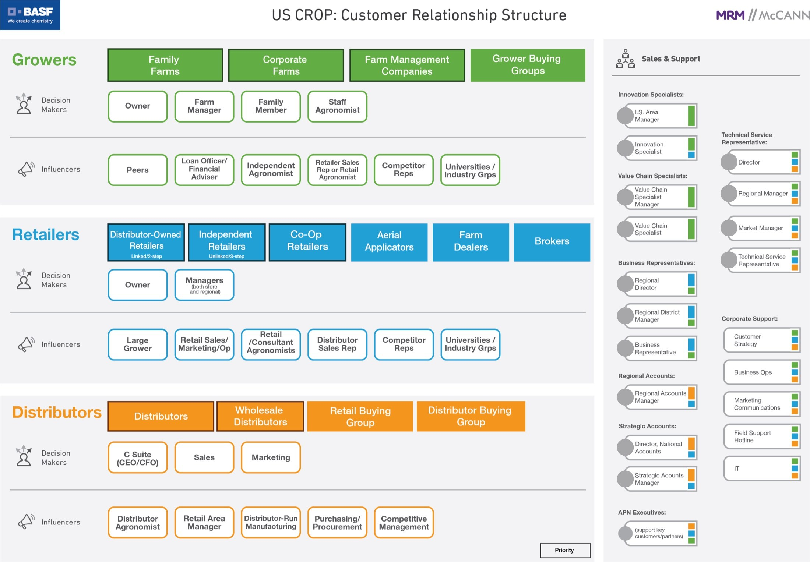
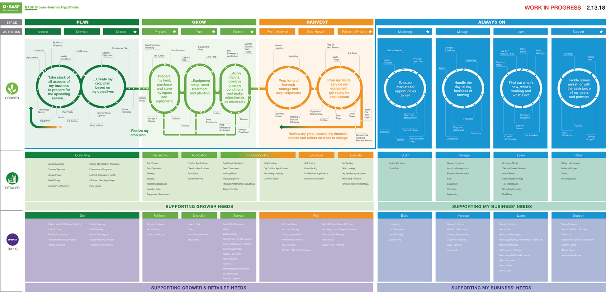
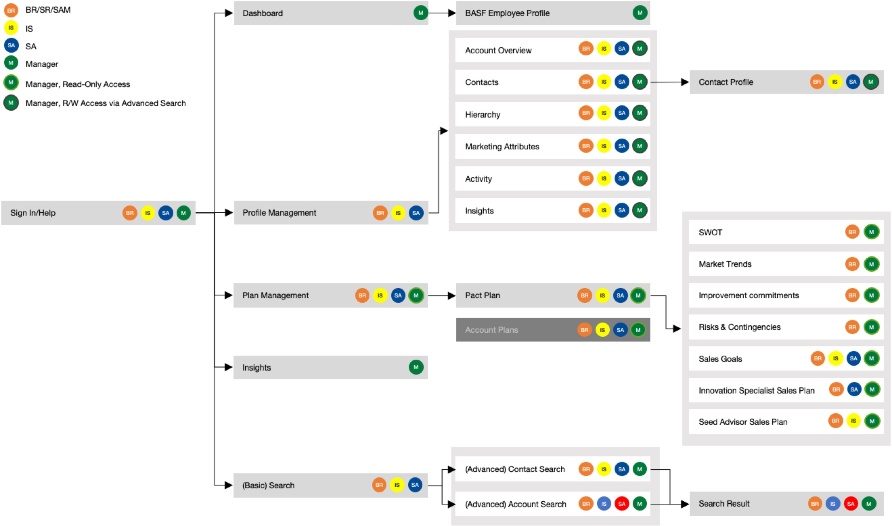
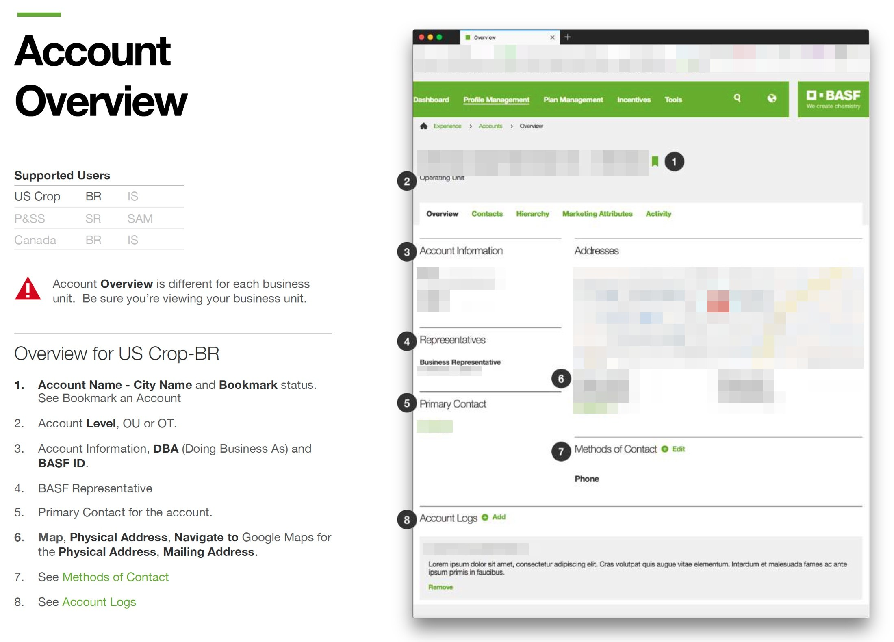
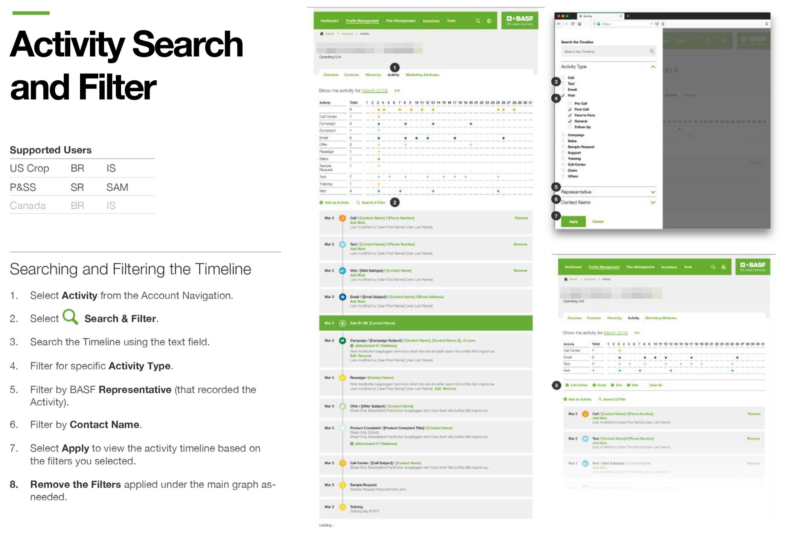

BASF wanted to change how agriculture thought of it: from a giant chemical supplier to a trusted advisor. That change would succeed or fail with the sales team in the field. Those reps were planning seasons across scattered tools, and even good tools were not getting used.

I joined the program in 2019 and became its lead designer in 2020. For most of that time I was the only UX designer on the client, so I owned design, the component library, and much of the product thinking.

## The problem was the relationship, not the screen

Research showed how much time the system was taking from customers. Preparing for one sit-down could take days. Reps told us:

> "Digital tools are insufficient or lacking, causing too much time spent finding basic information."

> "Rebate payment accruals are a time-drain and relationship killer."

BASF had already built capable tools. The trouble was that access, branding, and data entry differed from one tool to the next, so the tools never added up to a way of working.

## We mapped the people first

The team mapped how sales roles connected to growers, retailers, and distributors, then traced how each role moved through a growing season. That gave us a shared picture of who needed what, and when. My own background in farming helped here: I could talk with reps about their customers and seasons without translation.

## One sales solution

Design thinking workshops pointed to a single product: one login, one recognizable brand, one source of truth, and a structure that could grow to new roles. SalesX brought customer profiles, activity, planning, and reporting together, with versions for six personas.

The system had to carry real complexity, so I treated consistency as a product requirement. I managed the design library, added detailed annotations, and agreed on shared standards for spacing, type, and grids with the development team. That reduced errors between design and build.

## Module by module

We released in phases, with stakeholder demos in each sprint and feedback built into the rollout. Later modules added reporting and data management, then market analysis and forecasting. In 2022 we redesigned planning itself, turning a 4-module process into a two-way planning tool with 16 strategic segments.

## What changed

SalesX grew from a pilot of 40 test users to more than 800 sales professionals. People in the field said it better than I could:

> "Old systems we used were cart wagons and SalesX is a Ferrari."

> "You don't need training for SalesX. This system is so user friendly, it's like using Amazon or Delta."

The work also grew the relationship. It led to partner and customer portals, regional site redesigns, and a place at Adobe Summit. The product suite became a model MRM could carry into new business.

## What I took from it

Enterprise design is mostly relationship design. The screens worked because we first understood how people in the system depended on one another, and because we stayed with the product long enough to earn their trust.
