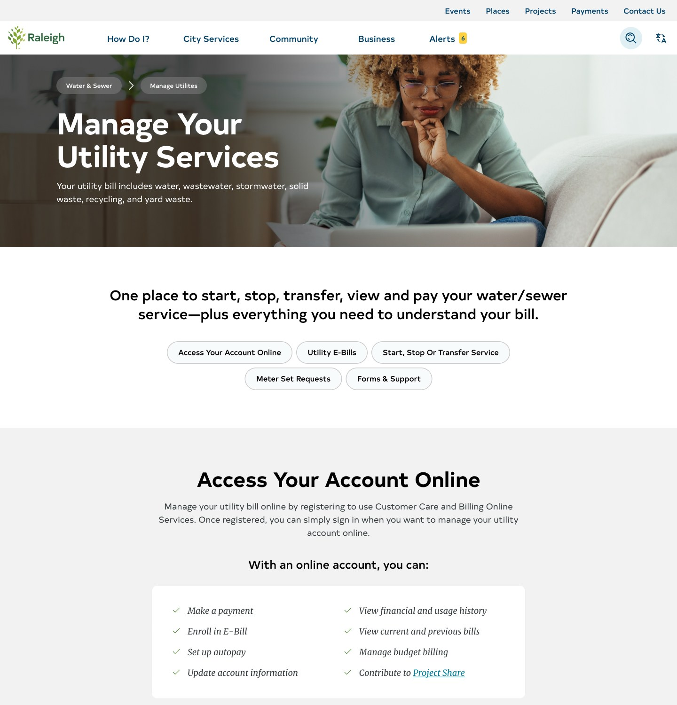

In 2024, the City of Raleigh's website drew more than 14 million page views. A crawl found 7,713 pages and 2,564 PDFs. Yet 63.3% of visits stopped at one page. People came to pay a water bill, find a park, or check for a road closure, and the site made them work for it.

Our job was to rebuild that site around what residents came to do. Partway through, the job got harder.

## First, the team changed

An acquisition cost the project nearly its entire original team. The client had just lost the people who won the work. I stepped into a fragmented group across Detroit, New York, Manila, and London, and helped rebuild the workflow and the client's trust through weekly sessions and clear decisions.

That mattered as much as any screen. A city can't plan its new front door around a partner it doesn't believe in.

## Deciding what the site must solve

We didn't start from zero. A March 2024 tree test with 159 Raleigh-area participants had compared the current site with two new structures. First-click success was 65% on the current site, 89% on a persona-based structure, and 94% on an action-based one.

That pointed to a navigation built around tasks, not departments. Using the city's analytics and audience work, we ranked 14 use cases the site had to solve, led by paying a utility bill. Then we took the sitemap to city staff in workshops.

Staff made it better. One team sorted 53 transportation services into seven groups, and that started a useful debate about customer-facing labels versus internal language. Others caught problems we couldn't have seen. A "Health and Safety" label, for example, promised something the city doesn't own, because public health in Raleigh is a county job. In government, a label can be a statement of responsibility.

## Testing with residents, and changing it as we went

A survey drew 46 responses, and we held 11 moderated sessions with residents and business owners. Each person tried two real tasks: renting a shelter at Pullen Park and transferring water service.

We didn't wait for the report to act. When feedback repeated, we changed the prototype halfway through, so later participants could confirm or reject each fix.

- **Labels:** "How Can I?" became "How Do I?", and vague section names became clear ones. "Grow Raleigh" sounded like a city program, so it became "Growth Within Raleigh."
- **Navigation:** the menu became sticky. Parks moved out of City Services, because people read that label as water, sewer, and trash.
- **Rentals:** the table gained photos and more filters, and mandatory fees moved up so people could trust their total.
- **Water service:** we added step-by-step directions, and people felt surer of the task.

Some findings pointed past the website. One participant described the city's forms this way:

> "Only tech savvy people can download these, open them up in a document reader, print it, or fill it out, and send it back to the city."

## One place for alerts

The old alerts page was a hub that sent people elsewhere, and city staff were clear that a new page for each alert type was not the answer. We planned one Alerts page reachable from the main navigation. Residents told us what would earn their trust: real-time, high-priority updates, and nothing stale.

## What changed

The work gave Raleigh a task-first navigation, tested page designs, and a citywide alert system design. The client presented it to City Council and to residents, where city leaders responded with strong praise.

## What I took from it

Government sites aren't really about information architecture. They're about who is responsible for what, in words a resident can act on. The same was true of the project itself: when a team falls apart, people need steadiness before they need another deck.
