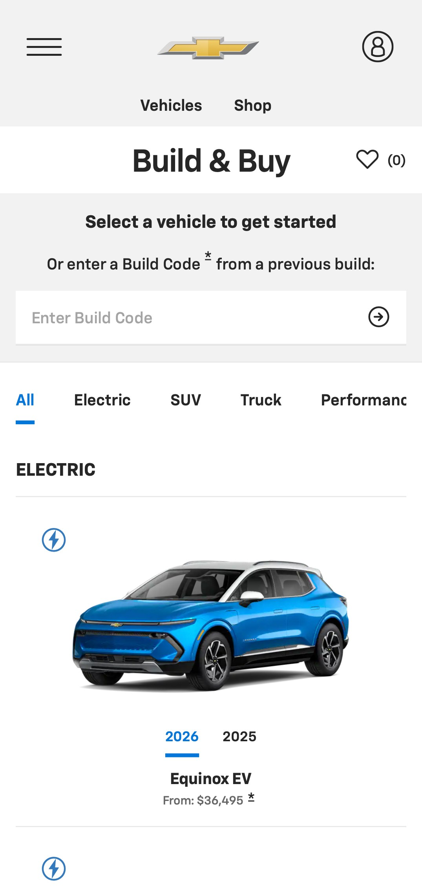
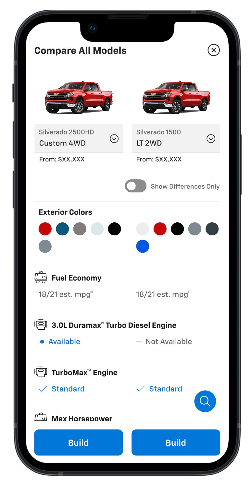

Build & Price is where a shopper stops browsing and starts deciding. It is also where GM's complexity comes straight to the surface: models, trims, packages, colors, and pricing, all depending on one another.

I worked with GM's retail team on the configurator from 2024 into 2025, leading UX for MRM alongside product, visual design, and development partners.

## Start with the decision people are making

Choosing a vehicle shouldn't feel like filling out a spec sheet. The selector leads with the vehicle, a starting price, and simple categories, so people can orient themselves before any of the detail appears. A build code lets someone pick up a saved build where they left it.

## Comparison was the missing step

Chevrolet asked for a better way to compare its own vehicles and move people toward the configurator. The hard part was electric and gas side by side, because the two don't share the same language. Battery capacity and engine displacement don't line up, and cost of ownership works differently.

We benchmarked how other manufacturers explain those differences, then asked what GM's existing data could support. That shaped the rest of the concept:

- Fixed headers, so people never lose track of what they're comparing.
- Columns they can add, remove, and scroll, rather than a fixed set.
- A search for specific features that stays within reach.
- Color and clear states that make long lists faster to scan.
- A "Show differences only" option, so the table can answer the real question.

The Build button stays fixed at the bottom of the screen, so comparing always leads to a next step.

## One experience, several brands

The configurator also had to stretch beyond Chevrolet. We produced GMC versions of key screens, including the configurator, vehicle search, and vehicle details, and explored side sheets with expanders to hold more detail without leaving the page. That work tested the shared system described in [the design language case study](/work/general-motors-global-design-system/).

Electric vehicles added their own needs, including battery data on model cards. We also explored how towing information could fit into the build flow, so truck buyers could get answers while configuring.

## What I took from it

A complicated product doesn't need a complicated experience. It needs a clear order of decisions, and honest help at the moment each one gets hard.
