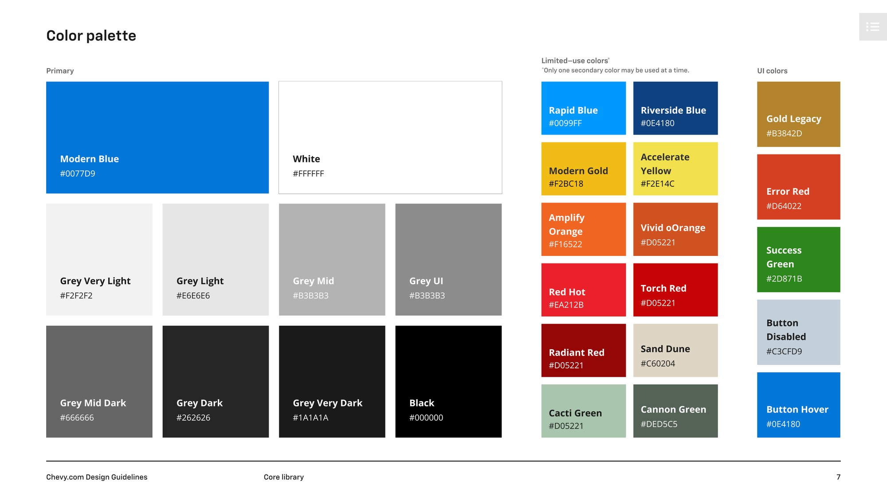
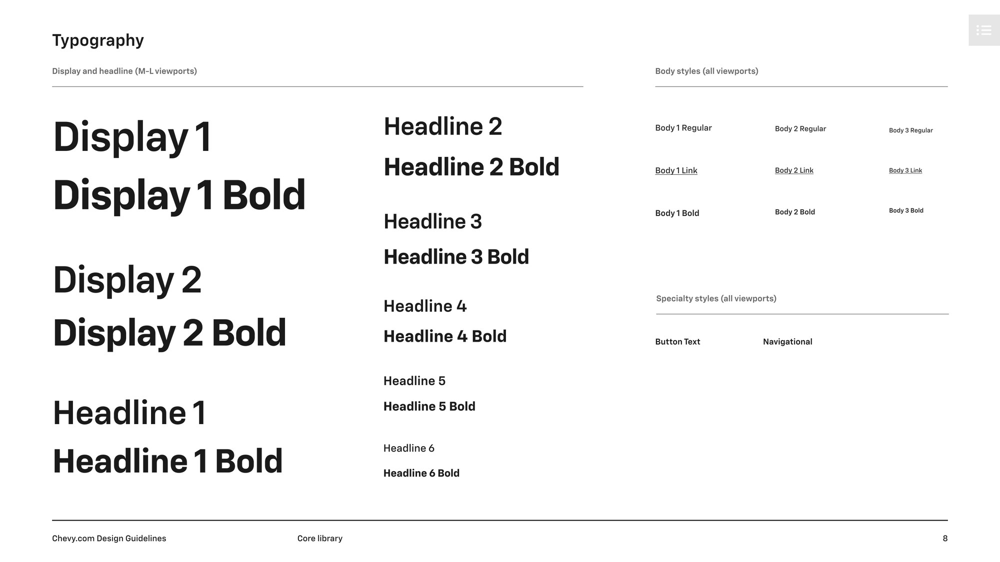
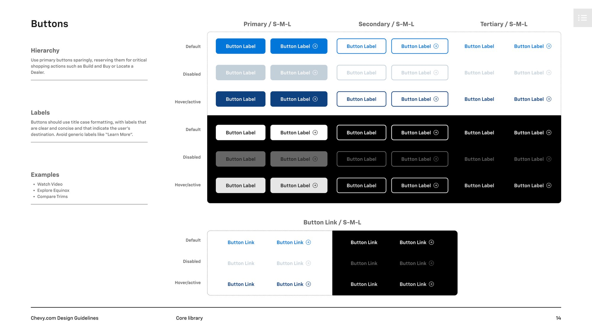
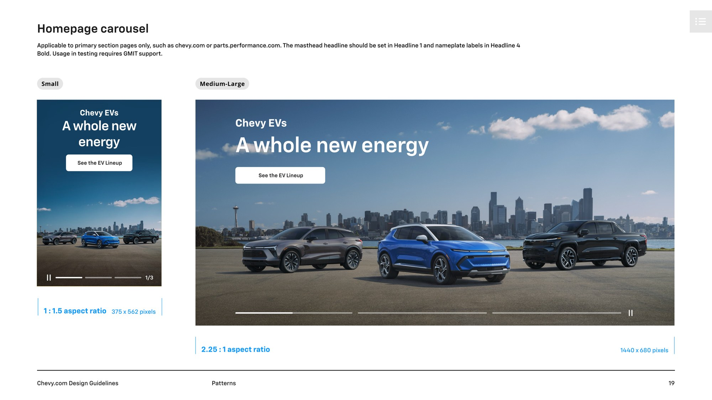
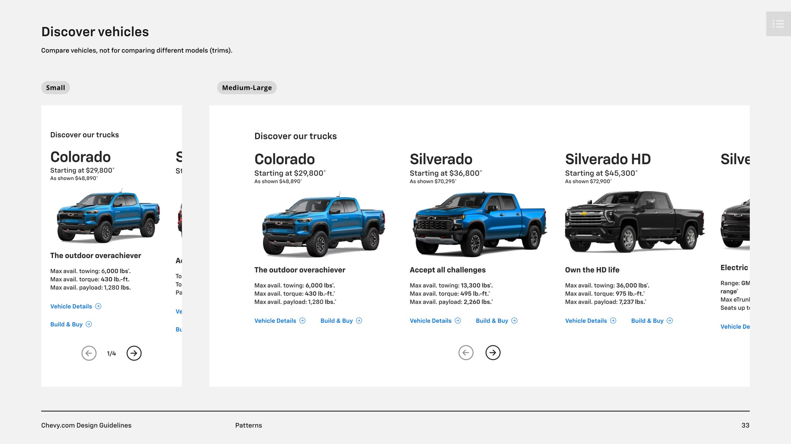

A design system is easy to admire and hard to adopt. General Motors sells through brands that look and sound different on purpose, while their shopping experiences have to behave the same way. The work was to find out exactly where a brand ends and a system begins.

My history with GM's design language goes back to 2019, when I started on Owner Center work inside the Quantum design system. By 2024 the question had grown. GM was building one retail experience that several brands would share.

> Ensure consistency in design is at the core of our approach, driving positive user experiences, reinforcing brand identity, and upholding online credibility and professionalism.

## A reskin showed us where the system was weak

The clearest test was simple. We took a set of Chevrolet comps and applied GMC styling to them. It should have been mechanical, but it surfaced a long list of questions and inconsistencies, because too many decisions lived in individual screens instead of shared rules.

That changed the work. Instead of treating each brand as a new set of comps, we separated what belonged to the brand from what belonged to the system.

## Rules a team can actually use

The Chevy.com Design Guidelines took shape as a 55-page reference in four parts: library elements, patterns, copy style, and resources. Color, type, grids, buttons, forms, and navigation sit in the library, with each one defined by how and when to use it.

States and hierarchy matter as much as the look. A button page isn't only a set of shapes. It says that primary buttons are reserved for critical shopping actions, so the system guards the path to purchase.

## Patterns carry the brand

Components alone don't make a page. The patterns section shows how they come together at small, medium, and large sizes for real retail moments, from homepage offers to in-page shopping tools.

## Details became decisions

Much of the real work happened in small questions: rounded corners, letter spacing, and how each typeface needed adjusting to work across brands. Each brand's visual identity went through formal review, with color, type, and elements approved one at a time. Treating those details as tokens gave design and development a shared source of truth.

## What I took from it

Multi-brand systems succeed when they say no to the right things. The brands should differ where a customer can feel it, and match everywhere a customer has to think.
