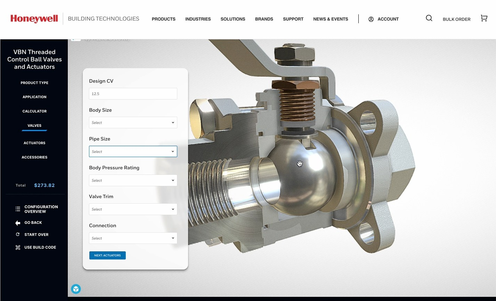

Choosing a building product can mean working through dense technical data, compatibility rules, and part numbers. Honeywell's ambition was blunt: let customers configure complex hardware and software with the ease of customizing sneakers online.

It wanted one global configurator across Fire, Security, Building Management Systems, and Energy. The data wasn't complete, the MVP date was fixed, and leadership expected a lot.

## The real gap was a shared picture

Two problems sat side by side. Users were overwhelmed by technical detail. Design teams across the business lacked shared patterns, so each group pictured something different.

More specification wouldn't fix that. People needed to see the same destination.

## We filmed the future

We worked with creative and motion teams to produce a sizzle reel showing the ideal experience, including 3D product views, and used it to help stakeholders look past small improvements. It was a design tool as much as a presentation: once everyone had watched the same product, the arguments became more useful.

## Then we built the part that counted

The film set the direction. Delivery came from rapid prototypes, working sessions across teams, and progress checks with the client twice a week.

The design turned a catalog problem into a guided conversation:

- **Guided recommendations** help a customer start from a need, not a part number.
- **Compatibility mapping** keeps them from building something that won't work.
- **Predictive logic** narrows the choices as they go.

That work connected to a wider effort I supported on Honeywell's site, including discoverability, product grouping, and taxonomy across its web ecosystem. A selector can only be as clear as the structure behind it.

## What changed

We delivered an MVP and the concept film. Honeywell's CIO called it one of the company's most exciting digital initiatives, and it became an example of UX and creative disciplines working as one team.

## What I took from it

When a project is stuck on incomplete data, a vision can be the most practical thing you make. It won't replace the hard logic, but it gives everyone a reason to go and finish it.
