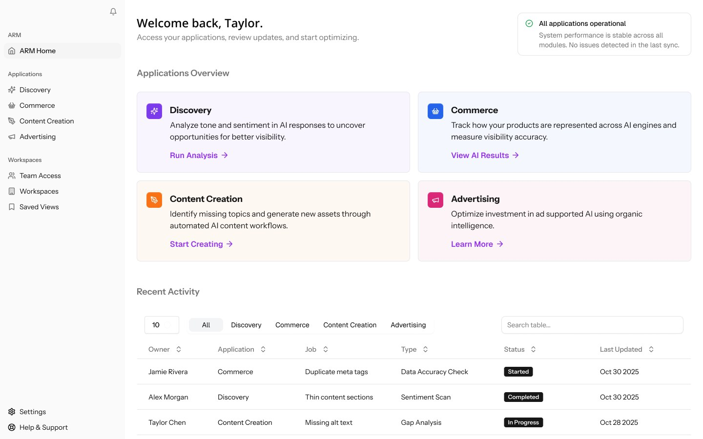

Brands have spent decades learning to build relationships with customers. Now a customer may ask an AI what to buy, and that system shapes the answer before a brand's website ever loads. MRM's Agent Relationship Management platform, or ARM, starts from that shift: a brand needs a relationship with the customer and with the AI that advises them.

There wasn't an established pattern for this. My job in 2025 was to help define what the product could be.

## Limited inputs, real decisions

ARM's scope draws on proprietary technology, lifecycle data, and AI-driven personalization. It aims to shape next-best actions, improve how a brand appears in AI-generated answers, and strengthen the full customer journey. That is a lot to ask a team to imagine from a description.

So we made it visible. Working with one other designer, I produced concept screens for more than eight flows, from a single comp to 25 or more per flow, while the product definition was still forming. Pictures gave the team something specific to disagree with.

## Frameworks before features

The harder work sat under the screens. I ran working sessions across engineering and UX to shape early frameworks for AI-driven workflows, a modular architecture, and decision paths where a machine, not a person, takes the next step.

I applied systems thinking to three goals: a structure that could scale, one that could adapt to different brands, and one with ethical governance built in from the start.

## What changed

The concept screens went in front of Omnicom's CEO and drew a strong positive reaction. The work helped establish ARM's direction, and I could already see where it might serve clients who were struggling with personalized content and with discoverability in AI answers.

## What I took from it

When nobody has seen a product category before, a fast, specific picture is worth more than a careful abstract one. It also changed how I think about users. Soon, some of the most important readers of a brand's experience won't be people at all.
