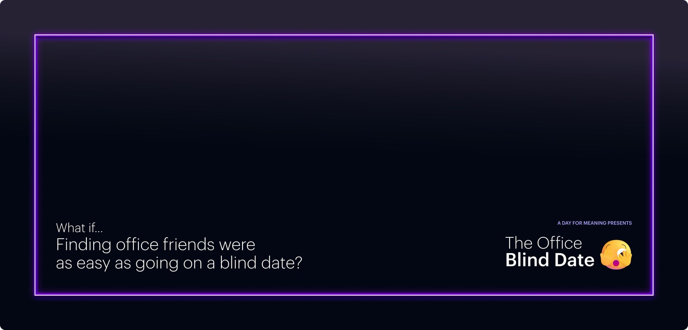

Agency designers can spend years on client work and rarely practice anything else. New people learn alone, and experts get stuck on their accounts. In 2019, in my first months at MRM, I helped start something small to change that: the UX Jam Session.

## Start with a short problem

A jam gave designers a quick challenge and very little time. The aim was to think fast, generate lots of ideas, and explain them clearly. It also did something a training deck can't, by putting new team members beside seasoned veterans so that experience passed between them in the work itself.

## Keep changing the format

Jams only work while they feel fresh, so we kept changing them.

- **2020:** when Covid sent everyone home, we adapted the sessions and added design challenges. We also started coffee and collaboration sessions, so people could still connect and teach each other.
- **2021:** we retooled the challenges and expanded coffee sessions to the Toronto and New York offices.
- **2022:** our planning group grew from two people to four, and we began inviting groups outside UX.
- **2023:** jams covered topics such as AI and designing with lists. We also added research lunch-and-learns and UX Unplugged, a biweekly open office hour where people at every level could share what they knew.

## Open the tools to everyone

Figma was becoming central to how MRM worked, and that shouldn't have stopped at the design team. With two colleagues, I built and taught three progressive courses: Figma 101, 201, and 301, open to every department. In 2025, I led more workshops as creative teams went deeper into the tool, and I helped set the process for getting and keeping Figma licenses.

## Connect people outside of design

Not every useful idea was about design. During MRM's A Day For Meaning, my team's idea was chosen to go forward. It became Office Blind Date, a program built with an operations team of eight, where employees had lunch with 10 randomly assigned coworkers from other departments. I ran idea workshops and created its campaign, right down to the signs in the bathrooms. Surveys before and after were built in to measure whether it worked.

## What changed

What began as one team's practice grew into a set of habits that reached other offices and departments. Alongside it, I mentored newer designers and an analyst through MRM's mentorship program.

## What I took from it

You don't need a management title to build a team's culture. You need a small, repeatable thing that people want to show up for, and the patience to keep changing it once they do.
