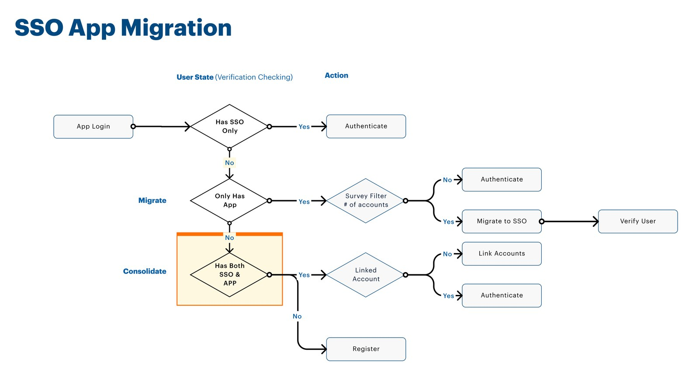

New York Lottery players don't think in products. They think, "I play the Lottery." But the website, the official app, Collect 'N Win, and Second Chance each sat in its own part of the experience, and the account had to connect them.

Starting in 2022, I worked on a single sign-on and profile experience across all four.

## Sign-on is where trust begins

A login screen looks like a small thing. Here it carried a lot: a state lottery has compliance requirements, a wide range of ages and abilities, and players who may hold rewards and promotions in their account. The design had to feel simple and hold up to scrutiny.

The work covered the full set of account moments: registering, signing in, forgetting a password, and updating a profile. Each flow was redesigned or newly created for all four experiences, so the account behaved the same way wherever someone met it.

## Moving people without losing them

Designing a new front door is one job. Moving existing players through it is another.

In 2024, the app moved to the unified system. That meant designing for the states in between: people arriving with an old login, guests, interstitial messages that explained what was changing, and promotions that had to keep working through the move. These in-between states are rarely in a portfolio, but they decide whether a migration feels seamless or broken.

Every login was sorted first. People with only the new account signed in, people with only the app migrated, and people with both had their accounts linked.

I led the architecture for the sign-on enhancements and worked across agencies, keeping every flow in line with compliance.

## What changed

Players gained one account across the website, the official app, Collect 'N Win, and Second Chance. The work also laid the groundwork for a larger platform change, which is often the real value of unglamorous infrastructure.

## What I took from it

The best sign-on work is invisible. Nobody thanks you for a login that works, but everything a program wants to do next, from rewards to personalization, depends on knowing who someone is.
