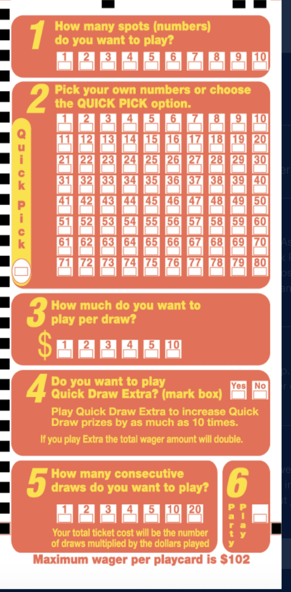
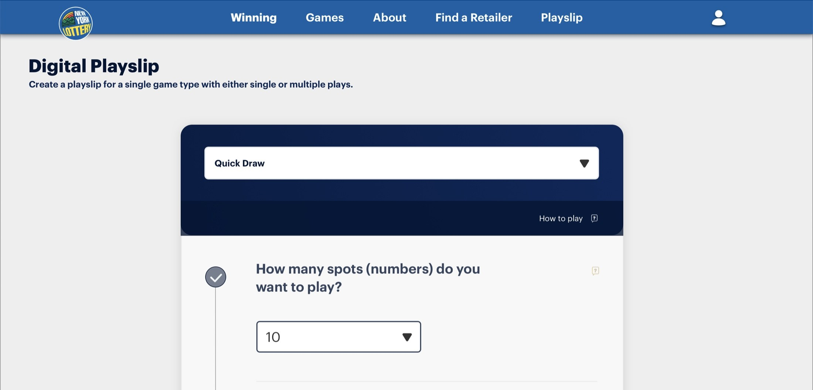
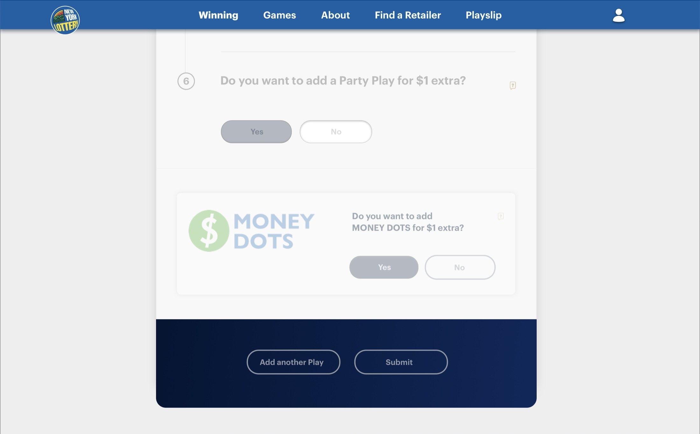
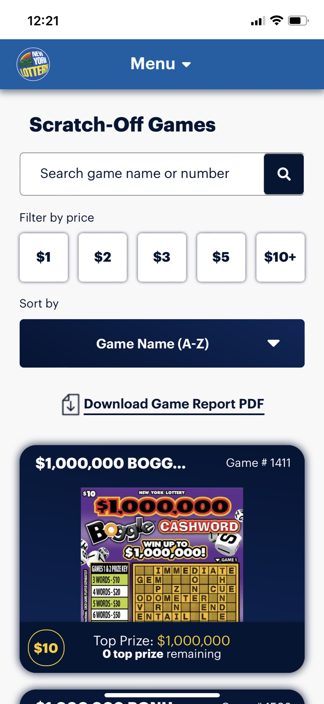
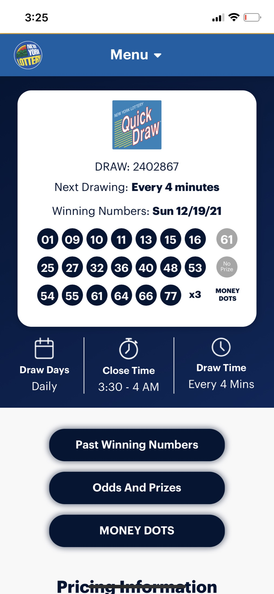
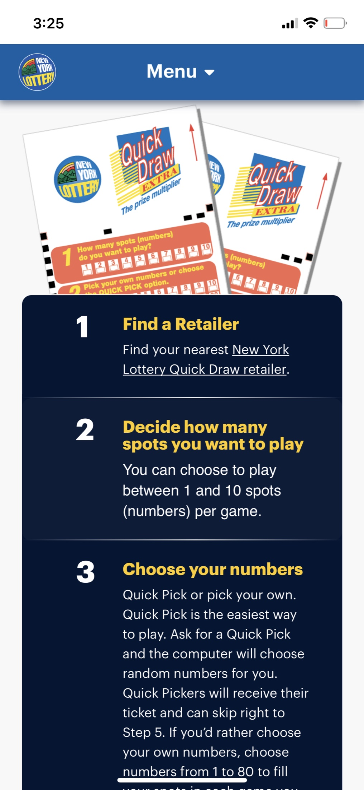

Every lottery player in New York knows the paper playslip. You fill in small bubbles, carry it to a retailer, and hand it over. It has rules and options printed in tiny type, and it varies from game to game. Our job was to rebuild that ritual on a phone without losing the retailer at the end of it.

I joined the New York Lottery team in 2021 as a senior advisor, then served as Product Design Lead on this cross-agency project. I worked with a UI designer, producers, and teams at MRM and McCann.

## The form was the system

Paper hides a lot. A single Quick Draw slip asks how many spots to play, which numbers, how much per draw, whether to add extras, and how many draws. Each game has its own logic, and the design had to handle all 10 draw games with one pattern.

It also had to respect the realities of a state lottery: compliance, responsible play, and a wide range of ages and abilities.

## Numbered steps that unlock

We started by stripping back. The first rounds removed color, numbered each decision, and made steps unlock in sequence. A footer kept a running total, so the cost of a play was never a surprise. Dropdowns became checkboxes where there were only a few options, because one less tap matters when you are standing in a store.

## Testing with the game people know

We moved user testing to Powerball, because heavy and casual players both know it and its rules are easier to follow. That shaped a custom number board, a clearer Quick Pick, and a summary page where players can review or change a play before it counts.

The flow ends with a QR code. A player finishes on their phone and scans at a retailer, so the store remains part of the experience. It also reduces the need for paper, which supports New York's carbon neutrality plans.

## Part of a bigger site

The playslip had to live inside a growing product, so I worked on the surrounding system too. That included one sign-on across the site, app, Collect 'N Win, and Second Chance, a shared Figma library, and translation of the site into 12 languages.

## What changed

The team had no real design system when I arrived, only a one-page guide. It left with a unified library and a shared way of working, and designers I mentored took on more of the strategic thinking. In 2022 McCann and MRM won a five-year agency-of-record deal for the Lottery's digital work.

## What I took from it

Good digital versions of physical rituals keep what people already trust and remove the rest. Compliance was a design material here, not a blocker: every rule had to be clear enough to follow in a store line.
