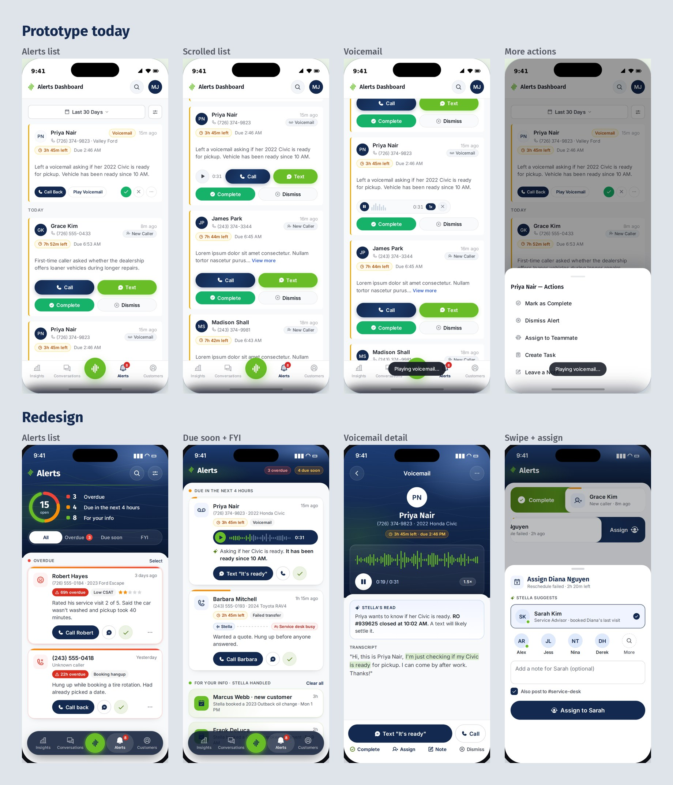

When an AI agent answers a dealership's phones, its work doesn't end with the call. Someone may still need to call a customer back, handle an upset caller, or pick up a transfer that dropped. Those follow-ups become alerts, and alerts are where the AI hands the job back to a person.

I run product and design for this experience at STELLA. The question here was simple: when a service advisor opens the app, can they tell what needs them first?

## Everything looked equally urgent

In our prototype, every alert card carried four equal buttons, so urgency and type competed for attention. A dropped transfer with a customer waiting looked much like a note that needed nothing at all.

I reworked alerts around three questions, each with one job on the card:

- **The strip says how soon.** Urgency runs along the card, from Now to hours left.
- **The tile says what.** A category tile names the kind of alert.
- **The button says what next.** One primary action leads, and the rest step back.

We also split alerts into two kinds. Actionable alerts need a person. Informational ones record something STELLA already handled, so they don't ask for the same effort.

## Closing the loop on desktop

An alert often leads to a conversation, and that exposed a bigger gap. On desktop, a service desk could read a text thread but not answer it, so handoffs happened elsewhere. The study turns that record into a working inbox, with a place to take over a thread and reply, and customer context beside it.

Mixing AI, customers, and staff in one view raised a question I've studied since my Lab313 days: who am I talking to? So each voice is visually distinct, and internal notes get three separate cues so a team note never reaches a customer.

## Designing so the numbers can't be gamed

Dealer groups need to trust these numbers across every rooftop. If a response target can be loosened after the fact, late work can be made to look on time. So the design fixes each target when the alert is created, keeps an append-only history that admins can't edit, and flags suspicious patterns.

Access follows the same plain logic, in three answers: a person's role, where they work, and what they can do in each module.

## Where it stands

This is a study, not a shipped release. I took it to leadership in September 2026 as a phased plan, with each phase shippable alone. Conversations with service managers come before the larger inbox work, because the problems we think we see still need checking with the people who live them.

## What I took from it

Good AI products are mostly about the handoff. The agent can do a lot, but the moment it needs a person, the interface has to make the next step obvious and the record trustworthy.
