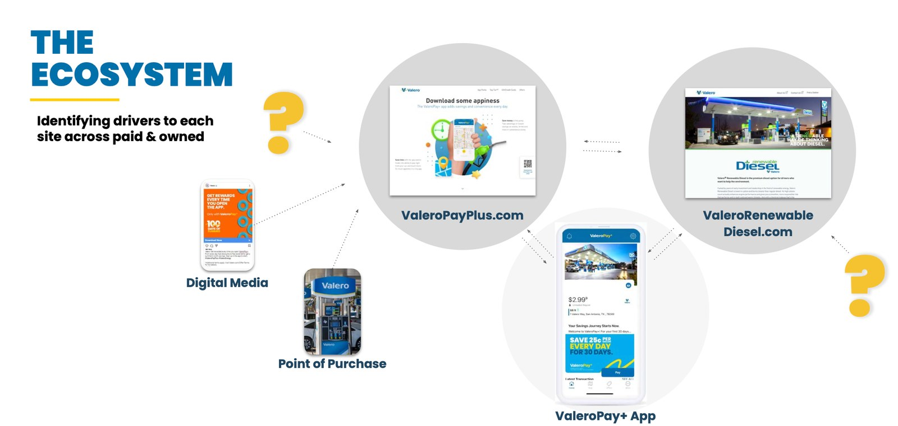

Valero's ValeroPay+ app was the center of a growing ecosystem, with ValeroPayPlus.com and ValeroRenewableDiesel.com around it. Those sites had grown up separately, and nobody could say clearly what each one was for.

The brief asked exactly that: what business value and user benefit do these two sites bring to the wider ecosystem, and how should the experience improve? Working with McCann New York, I helped run an audit designed to answer it, not just list problems.

## Three phases, each with a job

**Map it.** We reviewed existing materials, Google Analytics, and app store data, and interviewed stakeholders. That gave us an ecosystem map and the questions for the next phase.

**Ask people.** We wrote branching Hotjar surveys around real reasons to visit, such as station finding, payments, offers, compatibility, and support. Alongside heuristic evaluations and a competitive review, that research shaped six personas with their own journeys.

**Decide.** We joined the journeys into a matrix of touchpoints and weighed each recommendation against the effort it would take, so Valero could see where to start.

## People arrived with a task

The personas kept the findings concrete. Olivia was overwhelmed and needed saving money to stay simple. Ben wanted plain facts about renewable diesel. Arturo tracked prices and rewards closely. Owen managed a fleet and needed resources to plan.

They shared one thing: nobody came to read about a brand. People came for app support, help with payments, card requests, promotions, and practical information such as fuel data sheets. They also wanted locations, convenience store options, and tools that saved time and money.

Valero, meanwhile, needed branded content and a home for its distributors and dealers. Competitors had already made serving both consumers and businesses from one web presence the standard.

## Bring the answer back to the question

We found far more opportunities than the brief asked about, and the risk was burying the answer under them. So we sorted them, then returned to the original question about the two sites.

The recommendation was a minimum viable site that delivered the basics well, then grew over time, with a standalone section that speaks to customers. App, fleet, and longer-term ideas sat in their own groups, so they didn't crowd out the first step.

## What changed

Valero received an ecosystem map, personas, a journey matrix, and a findings report it could act on. Stakeholders received the report warmly.

## What I took from it

An audit earns its keep by narrowing. Finding 100 problems is easy. The value is in saying which handful matter, and in what order, for the question the client actually asked.
